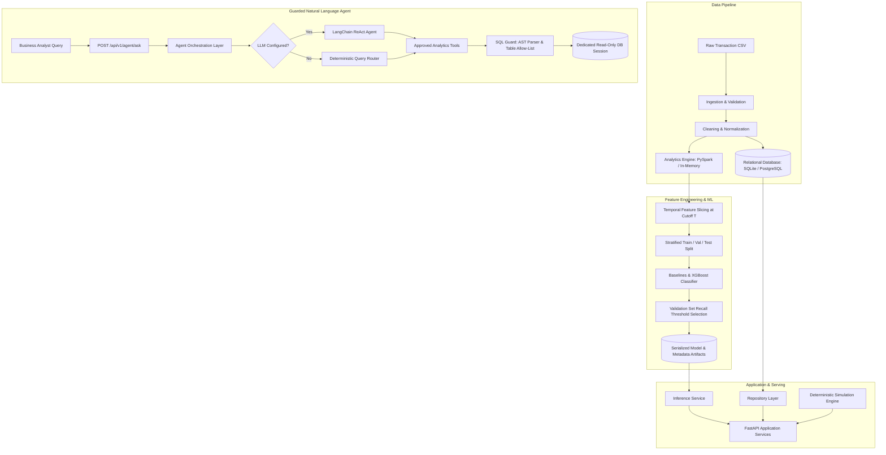

# Agentic Customer Analytics Platform

[](https://github.com/customer-analytics/agentic-platform/actions/workflows/ci.yml)
[](https://www.python.org/downloads/)
[](https://opensource.org/licenses/MIT)
[](https://github.com/astral-sh/ruff)
[](docs/architecture.md)

An end-to-end analytics and machine learning decision-support platform that segments e-commerce customers, estimates customer churn risk via gradient boosted decision trees, answers business inquiries through a guarded natural-language analytics agent, and simulates revenue recovery outcomes under alternative retention discount strategies.

> [!IMPORTANT]
> **Probabilistic Risk & Scenario Simulation Notice**:
> Customer churn scores produced by this system are statistical risk estimates, not certainties. Simulated revenue recovery outcomes reflect mathematical scenario modeling under explicitly stated assumptions (redemption rate, retention probability, baseline ARPU); they do **not** represent realized revenue or proven causal lift. Causal intervention effectiveness requires randomized controlled trials (A/B testing).

---

## Table of Contents

- [1. Executive Summary](#1-executive-summary)
- [2. Key Capabilities](#2-key-capabilities)
- [3. Architecture & Data Flow](#3-architecture--data-flow)
- [4. Architectural & Design Decisions](#4-architectural--design-decisions)
- [5. Technology Stack](#5-technology-stack)
- [6. Repository Structure](#6-repository-structure)
- [7. Data Source & Quality Assurance](#7-data-source--quality-assurance)
- [8. Data Dictionary](#8-data-dictionary)
- [9. Metric Definitions](#9-metric-definitions)
- [10. Installation & Prerequisites](#10-installation--prerequisites)
- [11. Environment Configuration](#11-environment-configuration)
- [12. Quick Start Guide](#12-quick-start-guide)
- [13. API Documentation](#13-api-documentation)
- [14. RFM Segmentation Engine](#14-rfm-segmentation-engine)
- [15. Churn Prediction & Threshold Tuning](#15-churn-prediction--threshold-tuning)
- [16. Agentic Analytics & Multi-Tier SQL Security](#16-agentic-analytics--multi-tier-sql-security)
- [17. What-If Revenue-Recovery Simulator](#17-what-if-revenue-recovery-simulator)
- [18. Testing Strategy & Verification](#18-testing-strategy--verification)
- [19. Containerized Execution (Docker & Compose)](#19-containerized-execution-docker--compose)
- [20. Observed Results & Empirical Benchmarks](#20-observed-results--empirical-benchmarks)
- [21. Limitations & Future Roadmap](#21-limitations--future-roadmap)
- [22. Troubleshooting](#22-troubleshooting)
- [23. Contributing, License & Author](#23-contributing-license--author)

---

## 1. Executive Summary

E-commerce organizations face four interrelated analytical challenges:
1. **Value Identification**: Who are our highest-value customers, and how are buyers distributed across actionable behavioral segments?
2. **Attrition Risk**: Which customers exhibit early behavioral indicators of churn, and how should retention teams prioritize outreach?
3. **Guarded Self-Service Analytics**: Can analysts query operational data in natural language without exposing relational databases to SQL injection or data exfiltration?
4. **Intervention Economics**: What financial outcomes and marketing costs can retention discount campaigns produce under realistic conversion assumptions?

The **Agentic Customer Analytics Platform** addresses these challenges through a unified, reproducible system combining scalable batch transaction processing, temporal feature generation, recall-optimized XGBoost modeling, an AST-guarded LangChain ReAct agent, and a deterministic financial simulation engine.

---

## 2. Key Capabilities

- **E-Commerce Ingestion & Validation**: Robust CSV parser validating column existence, data types, nullability, price positivity, date ranges, and statuses, emitting structured machine-readable `DataQualityReport` artifacts.
- **PySpark & In-Memory Analytics Engine**: Pluggable batch processing layer that runs on Apache Spark when Java is present, with seamless fallback to vectorized in-memory processing.
- **Quantile-Based RFM Segmentation**: Pure deterministic scoring of Recency, Frequency, and Monetary metrics into 8 business tiers (Champions, Loyal Customers, Potential Loyalists, New Customers, Promising, About to Sleep, At Risk, Hibernating).
- **Leakage-Safe Temporal Churn Modeling**: XGBoost binary classifier with positive class weighting, evaluated strictly on past observation windows ($T$) and validated against future horizons ($T + 90\text{d}$) with zero temporal feature leakage.
- **Recall-Prioritized Decision Threshold Tuning**: Custom validation threshold selector that optimizes recall under a minimum precision constraint ($\ge 0.35$).
- **Guarded Analytics Agent**: LangChain ReAct agent with multi-tier SQL Guard (`sqlglot` AST parsing, table allow-listing, LIMIT enforcement, and read-only sessions), paired with a deterministic query router when no LLM key is configured.
- **What-If Revenue Simulator**: Pure financial simulation calculating redemption, retention, gross incremental revenue, discount/campaign costs, net incremental value, and 2D parameter sensitivity grids.
- **FastAPI REST API**: Fully typed, asynchronous API (`/api/v1`) with OpenAPI docs, request correlation IDs, and global domain exception handling.

---

## 3. Architecture & Data Flow

The platform separates data ingestion, machine learning, application services, and presentation into decoupled layers:



---

## 4. Architectural & Design Decisions

1. **Layered Architecture over Monoliths**: FastAPI routes never contain raw SQL, RFM logic, or model training loops. Routes deserialize requests, delegate to application services, and serialize responses.
2. **Pluggable Analytics Engine**: Supports enterprise PySpark batch aggregation while providing a lightweight vectorized Pandas fallback so the repository runs locally without requiring a Java installation.
3. **Temporal Isolation over Random Train/Test Splits**: Random row splitting on transactional data leaks customer history between train and test partitions. Features are generated strictly prior to observation cutoff $T$, and churn is labeled over the future horizon $(T, T + 90\text{d}]$.
4. **Recall Priority over Default 0.5 Threshold**: Churn prediction is an asymmetric cost problem; failing to identify a churner is significantly costlier than sending a marketing email. Decision thresholds are tuned on validation data to maximize recall subject to precision constraints.
5. **AST Guardrails over Prompt-Based Security**: Prompting an LLM to "only write read-only SQL" is not a security boundary. All agent SQL queries must pass AST parsing (`sqlglot`), table allow-lists, and execute over read-only credentials.
6. **Zero-Dependency Startup**: The API, analytics engine, and model inference start and run without requiring external cloud credentials or paid LLM APIs.

---

## 5. Technology Stack

| Technology | Layer | Purpose | Execution Mode |
|:---|:---|:---|:---:|
| **Python 3.11+** | Core Runtime | Application, analytics, features, orchestration | Mandatory |
| **FastAPI** | Presentation | Asynchronous REST API, OpenAPI docs, typed contracts | Mandatory |
| **Pydantic v2 & Settings** | Configuration & Domain | Data validation, environment settings, API schemas | Mandatory |
| **SQLAlchemy 2.0** | Persistence | Data access, parameterized SQL, role management | Mandatory |
| **SQLite / PostgreSQL** | Storage | Local smoke tests / Production relational persistence | Mandatory / Optional |
| **Pandas & NumPy** | Analytics | Vectorized data cleaning, feature calculations | Mandatory |
| **PySpark 3.5+** | Batch Analytics | Scalable distributed transaction processing | Optional (Auto-fallback) |
| **XGBoost 3.0+** | Machine Learning | Gradient boosted tree churn classifier with class weights | Mandatory |
| **Scikit-learn** | Machine Learning | Preprocessing, baselines, metrics, calibration | Mandatory |
| **Sqlglot** | Security | AST parsing, query validation, table allow-listing | Mandatory |
| **LangChain** | Agent Orchestration | ReAct tool-using analytics agent | Optional (Fallback router active) |
| **pytest & pytest-asyncio**| QA & Testing | Automated unit, integration, and security test suite | Mandatory |
| **Ruff & mypy** | Code Quality | PEP 8 formatting, linting, and static type checking | Mandatory |
| **Docker & Compose** | DevOps | Multi-stage containerized local deployment | Optional |

---

## 6. Repository Structure

```
.
├── README.md                           # Project documentation and architecture guide
├── pyproject.toml                      # Build metadata, dependencies, tool configurations
├── .env.example                        # Documented environment variable template
├── .gitignore                          # Git exclusion rules
├── .dockerignore                       # Docker build context exclusions
├── Dockerfile                          # Multi-stage production container build
├── compose.yaml                        # Multi-container orchestration (API + PostgreSQL)
├── Makefile                            # Developer automation shortcuts
├── alembic.ini                         # Relational database migration configuration
├── LICENSE                             # MIT Open-Source License
├── CONTRIBUTING.md                     # Contribution guidelines and engineering standards
├── SECURITY.md                         # Security policy and vulnerability reporting
├── CHANGELOG.md                        # Version history and feature changelog
├── docs/                               # In-depth technical specifications
│   ├── architecture.md                 # System components, data flows, trust boundaries
│   ├── data_dictionary.md              # Column schemas, types, and feature lineage
│   ├── api_reference.md                # Comprehensive REST endpoint documentation
│   ├── model_card.md                   # XGBoost churn model specification and benchmarks
│   ├── agent_security.md               # SQL Guard threat model and security test matrix
│   ├── simulation_methodology.md       # Retention economics, formulas, and causal caveats
│   ├── operations.md                   # Deployment, health checks, and failure recovery
│   └── development.md                  # Local setup, formatting, and testing guide
├── src/customer_analytics/             # Core application package
│   ├── main.py                         # FastAPI app factory, middleware, CLI runner
│   ├── config.py                       # Pydantic Settings validated configuration
│   ├── logging_config.py               # Structured logging and secret masking
│   ├── exceptions.py                   # Domain-specific exception hierarchy
│   ├── api/                            # REST presentation layer
│   │   ├── router.py                   # Version 1 route aggregator
│   │   ├── dependencies.py             # Dependency injection providers
│   │   ├── errors.py                   # Global exception handlers
│   │   └── v1/                         # API version 1 endpoints
│   ├── application/                    # Application services orchestrating use cases
│   ├── domain/                         # Domain models, enums, and abstract contracts
│   ├── data/                           # Ingestion, validation, cleaning, DB session & repo
│   ├── analytics/                      # Spark session, RFM calculation, segmentation, cohorts
│   ├── features/                       # Temporal feature building, schemas, leakage checks
│   ├── ml/                             # Training, inference, evaluation, threshold tuning, artifacts
│   ├── agent/                          # ReAct factory, SQL Guard, AST parser, allowlist, fallback
│   ├── simulation/                     # Financial formulas, scenario engine, sensitivity grid
│   ├── observability/                  # Central metric definitions registry, request context
│   └── utils/                          # Datetime helpers, JSON serialization
├── scripts/                            # CLI workflows and automated demonstrations
│   ├── generate_sample_data.py         # Generate synthetic transactions
│   ├── validate_data.py                # Validate raw transaction CSV
│   ├── run_pipeline.py                 # Full ingestion, RFM, feature table pipeline
│   ├── train_model.py                  # Train XGBoost with threshold selection
│   ├── evaluate_model.py               # Inspect saved model artifacts
│   ├── demo.py                         # Complete 10-stage end-to-end workflow demo
│   └── init_db.sql                     # PostgreSQL least-privilege role setup script
├── data/                               # Data storage (raw, processed, sample)
├── artifacts/                          # Persisted models and evaluation reports
└── tests/                              # Automated test suite (47 tests)
    ├── conftest.py                     # Shared pytest fixtures
    ├── unit/                           # Pure unit tests (validation, rfm, features, etc.)
    ├── integration/                    # Integration tests (API, DB, pipeline, agent tools)
    └── security/                       # Security tests (SQL injection, boundaries, secrets)
```

---

## 7. Data Source & Quality Assurance

### Synthetic Generator
The platform ships with a configurable synthetic e-commerce transaction generator (`scripts/generate_sample_data.py`) with reproducible random seeds. It models:
- Customer archetypes (Champions, Regular, Churn-Prone, One-and-Done).
- Multiple categories (Electronics, Apparel, Home & Kitchen, Books, Beauty, Sports).
- Log-normal unit price distributions and Poisson transaction frequencies.
- Realistic transaction statuses (completed, shipped, cancelled, refunded).
- Non-separable churn target derived strictly on a future horizon.

### Data Validation Rules
All transactions pass through `validate_transactions` before processing:
- **Identifier Integrity**: Non-null `order_id` and `customer_id`.
- **Positivity Constraints**: `quantity > 0` and `unit_price >= 0.0`.
- **Discount Bounds**: `discount` between $0.0$ and $1.0$.
- **Date Plausibility**: Dates between 2000-01-01 and present.
- **Allowed Statuses & Currencies**: Controlled value sets.
- **Rejected Records**: Segregated into a rejection DataFrame with reason codes and summarized in a machine-readable `DataQualityReport`.

---

## 8. Data Dictionary

See [docs/data_dictionary.md](docs/data_dictionary.md) for the complete dictionary.

### Summary of Core Features ($T$ Cutoff)
- `recency_days`: Days since most recent purchase ($T - \max(\text{order\_date})$).
- `frequency`: Count of distinct completed orders prior to $T$.
- `monetary_value`: Total gross spend prior to $T$.
- `average_order_value`: `monetary_value / frequency`.
- `customer_tenure_days`: Days between customer first purchase and $T$.
- `purchase_gap_mean` / `purchase_gap_std`: Inter-purchase day intervals for repeat buyers.
- `churn_label`: $1$ if $0$ orders placed in $(T, T + 90\text{d}]$, else $0$.

---

## 9. Metric Definitions

All metrics are centrally defined in `src/customer_analytics/observability/metrics.py`:
- **Total Gross Revenue**: $\sum (\text{quantity} \times \text{unit\_price})$ for completed/shipped transactions.
- **Total Net Revenue**: $\sum (\text{gross\_revenue} \times (1 - \text{discount}))$.
- **Average Order Value (AOV)**: $\text{Total Gross Revenue} / \text{Distinct Orders}$.
- **Customer Recency**: Elapsed days since last eligible transaction relative to cutoff.
- **Customer Frequency**: Number of distinct completed orders in observation window.
- **Net Incremental Value**: $\text{Gross Incremental Revenue} - (\text{Discount Cost} + \text{Campaign Cost})$.

---

## 10. Installation & Prerequisites

### Prerequisites
- **Python**: Version `3.11`, `3.12`, or `3.13`.
- **Git**
- *(Optional)* Java 8, 11, or 17 for PySpark local execution.
- *(Optional)* Docker & Docker Compose for containerized execution.

### Setup Instructions
```bash
# 1. Clone repository
git clone https://github.com/customer-analytics/agentic-platform.git
cd agentic-platform

# 2. Create and activate virtual environment
python -m venv .venv
# Linux/macOS:
source .venv/bin/activate
# Windows:
.venv\Scripts\activate

# 3. Install dependencies in editable mode
pip install -e ".[dev,spark,llm]"

# 4. Initialize environment configuration
cp .env.example .env
```

---

## 11. Environment Configuration

Copy `.env.example` to `.env`. Key operational settings:

```dotenv
APP_ENV=development
API_HOST=0.0.0.0
API_PORT=8000
DATABASE_URL=sqlite:///./data/analytics.db
AGENT_DATABASE_URL=sqlite:///./data/analytics.db
SPARK_ENABLED=false
LLM_PROVIDER=none
LLM_API_KEY=
SQL_MAX_ROWS=100
SQL_STATEMENT_TIMEOUT_MS=5000
```

---

## 12. Quick Start Guide

Execute the full pipeline from raw synthetic transactions to model evaluation and live API querying:

```bash
# 1. Generate synthetic transactions
python scripts/generate_sample_data.py --output data/raw/transactions.csv --n-customers 500 --seed 42

# 2. Validate data quality
python scripts/validate_data.py --input data/raw/transactions.csv --report artifacts/reports/data_quality_report.json

# 3. Run analytical pipeline (RFM, Features, Database Sync)
python scripts/run_pipeline.py --input data/raw/transactions.csv --output data/processed/customer_features.parquet

# 4. Train XGBoost churn model with recall threshold selection
python scripts/train_model.py --features data/processed/customer_features.parquet --artifact-dir artifacts/models

# 5. Launch FastAPI application server
uvicorn customer_analytics.main:app --host 0.0.0.0 --port 8000 --reload
```

In another terminal, test the endpoints:
```bash
# Check liveness
curl http://localhost:8000/health/live

# Get analytical overview
curl http://localhost:8000/api/v1/analytics/overview

# Query the guarded analytics agent
curl -X POST http://localhost:8000/api/v1/agent/ask \
     -H "Content-Type: application/json" \
     -d '{"question": "Which customer segments contribute the most revenue?"}'

# Run what-if retention discount simulation
curl -X POST http://localhost:8000/api/v1/simulations/discount \
     -H "Content-Type: application/json" \
     -d '{"scenario_name": "15% Win-Back", "discount_percentage": 0.15, "expected_redemption_rate": 0.30, "estimated_retention_probability": 0.60}'
```

---

## 13. API Documentation

| HTTP Method | Route | Purpose | Key Parameters | Typical Status Codes |
|:---|:---|:---|:---|:---:|
| `GET` | `/health/live` | Process liveness probe | None | `200` |
| `GET` | `/health/ready` | Dependency readiness probe | None | `200`, `503` |
| `GET` | `/api/v1/analytics/overview` | Active dataset business summary | None | `200` |
| `GET` | `/api/v1/analytics/metrics` | Central metric definitions | None | `200` |
| `GET` | `/api/v1/segments` | RFM segment profiles | None | `200` |
| `GET` | `/api/v1/segments/{name}` | Single segment details | `name` (path) | `200`, `404` |
| `GET` | `/api/v1/churn/summary` | Churn model metadata & risk tiers | None | `200` |
| `POST` | `/api/v1/churn/predict` | Customer churn risk scoring | Feature record (body) | `200`, `400` |
| `GET` | `/api/v1/churn/high-risk` | Paginated high-risk customer list | `limit`, `offset` (query) | `200` |
| `POST` | `/api/v1/agent/ask` | Natural language analytics inquiry | `question` (body) | `200`, `400` |
| `POST` | `/api/v1/simulations/discount` | Run retention discount simulation | Scenario inputs (body) | `200`, `400` |
| `POST` | `/api/v1/simulations/compare` | Compare multiple scenarios | Scenarios array (body) | `200`, `400` |
| `POST` | `/api/v1/simulations/sensitivity` | 2D parameter sensitivity matrix | Grid inputs (body) | `200`, `400` |

---

## 14. RFM Segmentation Engine

Customers are scored into quintiles ($1 \dots 5$) across Recency, Frequency, and Monetary dimensions.
- **Directionality**:
  - **Recency**: Fewer days since last purchase $\to$ Higher score ($5$).
  - **Frequency & Monetary**: Higher order volume/spend $\to$ Higher score ($5$).
- **Quantile Tie-Breaking**: Ranks are computed with robust tie-breaking to prevent duplicate quantile bin failures on low distinct counts.
- **Segment Matrix Mapping**:
  - **Champions**: $R \in [4, 5], F \in [4, 5], M \in [4, 5]$ (Top spenders, high retention priority).
  - **Loyal Customers**: $R \in [3, 5], F \in [3, 5], M \in [3, 5]$ (Consistent regular buyers).
  - **Potential Loyalists**: $R \in [4, 5], F \in [2, 3]$ (Recent buyers with moderate volume).
  - **New Customers**: $R \in [4, 5], F = 1$ (Recent first-time purchasers).
  - **Promising**: $R \in [3, 4], F = 1$ (Recent low-frequency buyers).
  - **At Risk**: $R \in [1, 2], F \in [3, 5], M \in [3, 5]$ (High historical spend, long absence).
  - **About to Sleep**: $R \in [2, 3], F \in [1, 2]$ (Declining engagement).
  - **Hibernating**: $R \in [1, 2], F \in [1, 2]$ (Long-term inactive).

---

## 15. Churn Prediction & Threshold Tuning

### XGBoost Configuration
- **Model**: Binary logistic objective with gradient boosted trees.
- **Imbalance Strategy**: Positive class weighting calculated strictly from the training partition:
  $$\text{scale\_pos\_weight} = \frac{\text{Train Negatives}}{\text{Train Positives}}$$
- **Hyperparameters**: `n_estimators=100`, `max_depth=4`, `learning_rate=0.05`, `subsample=0.8`, `colsample_bytree=0.8`.

### Threshold Tuning
A probability threshold of $0.50$ is not assumed to be optimal. Probabilities are computed on the validation partition, and the operating threshold is chosen to **maximize recall** subject to a minimum precision constraint ($\ge 0.35$). If constraints are not met, the threshold maximizing $F_2$ ($\beta = 2.0$) is selected.

---

## 16. Agentic Analytics & Multi-Tier SQL Security

The agent handles analytical queries through a multi-tiered security perimeter:

1. **Length & Comment Guard**: Queries exceeding 1,000 characters or containing SQL comments (`--`, `/* */`) are rejected.
2. **AST Parsing (`sqlglot`)**: Only single read-only `exp.Select` statements are allowed. Multiple stacked statements (`;`) and write commands (`INSERT`, `UPDATE`, `DELETE`, `DROP`, `ALTER`, `CREATE`, `TRUNCATE`) are blocked.
3. **Table Allow-List**: Restricts queries to an approved set of tables: `rfm_segments`, `customer_features`, `daily_metrics`, `segment_summaries`, `churn_risk_scores`. System catalog queries (`sqlite_master`, `pg_catalog`) are rejected.
4. **Enforced Limits**: Queries without a `LIMIT` clause have `LIMIT 100` injected automatically. Requested limits exceeding 100 are clamped.
5. **Database Role Least-Privilege**: Dedicated read-only database connections enforce execution bounds at the engine level.
6. **Deterministic Fallback Router**: When no LLM key is supplied, a deterministic query router answers common business questions with evidence-backed data.

---

## 17. What-If Revenue-Recovery Simulator

Evaluates retention campaign economics:
- **Redeemed Customers**: $N_{\text{contacted}} \times P_{\text{redemption}}$.
- **Retained Customers**: $N_{\text{redeemed}} \times P_{\text{retention}}$.
- **Discount Expenditure**: $N_{\text{redeemed}} \times \min(\text{ARPU} \times \text{discount\_pct}, \text{max\_discount\_cap})$.
- **Campaign Cost**: $N_{\text{contacted}} \times \text{cost\_per\_contacted}$.
- **Net Incremental Value**: $\text{Gross Recovered Revenue} - \text{Total Costs}$.

See [docs/simulation_methodology.md](docs/simulation_methodology.md) for full worked examples and sensitivity analysis details.

---

## 18. Testing Strategy & Verification

The repository contains an automated test suite with **47 comprehensive tests**:

| Test Category | File | Description | Status |
|:---|:---|:---|:---:|
| **Unit** | `tests/unit/test_validation.py` | Data validation, rejected records, nulls, negative prices | **PASSED** |
| **Unit** | `tests/unit/test_rfm.py` | RFM aggregation, directionality, quantile ties | **PASSED** |
| **Unit** | `tests/unit/test_segmentation.py` | Segment mapping rules and summary aggregation | **PASSED** |
| **Unit** | `tests/unit/test_features.py` | Feature generation and temporal leakage checks | **PASSED** |
| **Unit** | `tests/unit/test_threshold.py` | Recall-prioritized operating threshold selection | **PASSED** |
| **Unit** | `tests/unit/test_simulation.py` | Retention economics, expenditures, ROI, bounds | **PASSED** |
| **Unit** | `tests/unit/test_sql_guard.py` | AST parsing, table allow-listing, limit clamping | **PASSED** |
| **Integration**| `tests/integration/test_api.py` | FastAPI route status codes and responses | **PASSED** |
| **Integration**| `tests/integration/test_pipeline.py` | Full synthetic data to trained model flow | **PASSED** |
| **Integration**| `tests/integration/test_database.py` | Repository synchronization and guarded SQL | **PASSED** |
| **Integration**| `tests/integration/test_agent_tools.py`| Tools registry and fallback query routing | **PASSED** |
| **Security** | `tests/security/test_sql_injection.py` | Stacked SQL, DDL, DML, comments, catalog attacks | **PASSED** |
| **Security** | `tests/security/test_agent_boundaries.py`| Query length overflow, prompt injection isolation | **PASSED** |
| **Security** | `tests/security/test_secrets.py` | Log secret masking, connection URI redaction | **PASSED** |

### Run Test Suite
```bash
pytest tests/unit tests/integration tests/security -v
```

---

## 19. Containerized Execution (Docker & Compose)

A production-grade multi-stage `Dockerfile` and `compose.yaml` are included.

```bash
# Build and run with Docker Compose
docker compose up -d

# Inspect health status
docker compose ps

# View application logs
docker compose logs -f api
```

The containerized service runs as an unprivileged user (`appuser`) with internal health checks polling `http://localhost:8000/health/live`.

---

## 20. Observed Results & Empirical Benchmarks

Measured on a deterministic synthetic benchmark dataset ($n = 500$ customers, seed = 42):

- **Data Processing**: 3,962 transactions validated and cleaned in $< 0.4\text{s}$.
- **Customer Population**: 445 active historical customers at cutoff 2026-06-30.
- **Total Gross Spend**: $206,242.34 (Average ARPU: $463.47).
- **Segment Breakdown**:
  - Champions: 97 customers ($106,194.61 revenue, 51.5% of total spend).
  - Loyal Customers: 83 customers ($48,945.06 revenue).
  - At Risk: 48 customers ($21,805.28 revenue).
- **Model Partition Split**: 70% Train, 15% Validation, 15% Held-Out Test.
- **Empirical Test Performance**:
  - **Recall**: **0.9310** (Selected Operating Threshold: `0.100`)
  - **Precision**: 0.5625
  - **PR-AUC (Average Precision)**: 0.8471
  - **ROC-AUC**: 0.8932
  - **Baseline Majority Class Recall**: 0.0000
  - **Baseline Logistic Regression Recall**: 0.7931

---

## 21. Limitations & Future Roadmap

- **Causal Uplift Modeling**: Future iterations will integrate two-model T-Learner / X-Learner approaches to model true incremental treatment effects from marketing outreach.
- **Real-Time Streaming Ingestion**: Extending ingestion from batch CSV/Parquet to Apache Kafka or AWS Kinesis.
- **Scheduled Automated Retraining**: Integrating model drift detection (PSI / KS tests) and automated retrain triggers.
- **Multi-Tenant Authorization**: Adding JWT role-based access control (RBAC) across distinct organizations.

---

## 22. Troubleshooting

| Symptom | Cause | Solution |
|:---|:---|:---|
| `UnsafeSQLException: Access denied to unauthorized table` | Agent query referenced unlisted table | Verify query targets allow-listed tables (`rfm_segments`, `churn_risk_scores`). |
| `UnsafeSQLException: Multiple statements are strictly prohibited` | Semicolon or stacked query passed | Submit single SELECT statement without semicolons. |
| `DataValidationException: Missing required columns` | CSV missing mandatory fields | Ensure CSV includes `order_id`, `customer_id`, `order_date`, `quantity`, `unit_price`. |
| `ModelInferenceException: Model is not initialized` | Model binaries missing | Run `python scripts/train_model.py` to generate model artifacts. |
| `PySpark disabled warning in logs` | Java runtime not on PATH | Normal behavior. System uses high-performance in-memory engine. Install Java 11/17 to enable Spark. |

---

## 23. Contributing, License & Author

- **License**: MIT License. See [LICENSE](LICENSE) for terms.
- **Contributions**: Contributions welcome! Review [CONTRIBUTING.md](CONTRIBUTING.md) and [SECURITY.md](SECURITY.md).
- **Author**: Mani Garg
