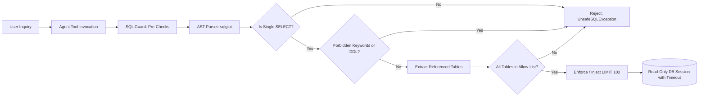

# Agent Security and Guardrails Specification

## 1. Threat Model & Security Philosophy

A natural language analytics assistant connected to operational data faces distinct attack vectors:
1. **Arbitrary SQL Injection & Destruction**: Model-generated or user-injected `DROP TABLE`, `DELETE`, `UPDATE`, or `INSERT` statements.
2. **Data Exfiltration**: Extracting sensitive customer personal data or internal database catalogs (`sqlite_master`, `pg_catalog`, `information_schema`).
3. **Resource Exhaustion & Denial of Service**: Stacked multi-statement queries, unbounded cartesian product joins, or queries returning millions of rows.
4. **Prompt Injection**: User prompts attempting to override agent instructions or coerce the agent into disclosing hidden secrets or database connection strings.

Prompt engineering alone is **not** an adequate security boundary. This platform enforces defense-in-depth across the application, AST parsing, and database role layers.

---

## 2. Multi-Tiered SQL Defense

### Tier 1: Query Pre-Validation
- **Length Constraint**: Enforces `sql_max_query_length` (default 1,000 characters). Queries exceeding this are rejected immediately.
- **Comment Rejection**: All SQL comments (`--` and `/* ... */`) are rejected to prevent token obfuscation.
- **Prohibited Token Filter**: Scans for keywords such as `PRAGMA`, `ATTACH`, `VACUUM`, `LOAD_FILE`, `INTO OUTFILE`.

### Tier 2: AST Parser (`sqlglot`)
- **Single-Statement Rule**: Rejects multi-statement or stacked commands (`;`).
- **AST Type Whitelist**: The root node must be an instance of `exp.Select`.
- **Node Walk Validation**: Traverses all nodes in the syntax tree (including subqueries, CTEs, and joins). Explicitly blocks `exp.Insert`, `exp.Update`, `exp.Delete`, `exp.Drop`, `exp.Create`, `exp.Alter`, `exp.TruncateTable`, `exp.Into`.

### Tier 3: Table & View Allow-Listing
- Recursively extracts all referenced table names across the AST.
- Rejects any query referencing tables outside the allow-list:
  `rfm_segments`, `customer_features`, `daily_metrics`, `segment_summaries`, `churn_risk_scores`, `cohort_retention`.

### Tier 4: Execution Bounds & Enforced Limits
- **LIMIT Enforcement**: Injects `LIMIT 100` if absent, or caps requested limits exceeding `sql_max_rows`.
- **Statement Timeout**: The database session enforces timeouts (default: 5,000 ms).
- **Client-Side Cap**: The repository uses `.fetchmany(max_rows)` to guarantee memory safety.

### Tier 5: Relational Role Least-Privilege
- Agent queries execute under dedicated read-only roles (`analytics_readonly`).
- Write permissions (INSERT, UPDATE, DELETE, CREATE, DROP) are revoked at the database engine level.

---

## 3. Query Policy Test Cases

| Query Submitted | Policy Outcome | Reason |
|:---|:---:|:---|
| `SELECT customer_id, monetary_value FROM rfm_segments LIMIT 10` | **ALLOWED** | Valid single SELECT on allow-listed table. |
| `SELECT * FROM rfm_segments; DROP TABLE rfm_segments;` | **REJECTED** | Multi-statement stacked queries strictly forbidden. |
| `DELETE FROM rfm_segments WHERE customer_id = 'C1'` | **REJECTED** | DML write statements forbidden. |
| `DROP TABLE rfm_segments` | **REJECTED** | DDL statements forbidden. |
| `SELECT * FROM sqlite_master` | **REJECTED** | System catalog access forbidden. |
| `SELECT * FROM pg_catalog.pg_tables` | **REJECTED** | System catalog access forbidden. |
| `SELECT * FROM secret_passwords` | **REJECTED** | Unauthorized table not in allow-list. |
| `SELECT * FROM rfm_segments -- bypass` | **REJECTED** | Comments prohibited in agent queries. |
