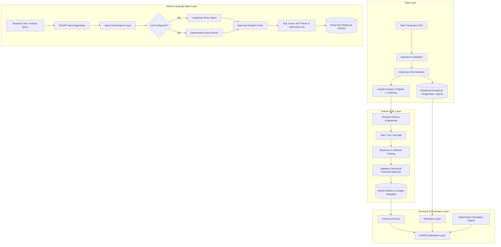

# Architecture Documentation

## 1. System Overview

The **Agentic Customer Analytics Platform** is a modular decision-support system designed to ingest high-volume e-commerce transaction data, compute quantile-scored RFM (Recency, Frequency, Monetary) metrics, train recall-optimized XGBoost churn classification models, answer natural language business inquiries through guarded tools, and evaluate retention economics using a deterministic simulation engine.

## 2. Layered Architecture Principles

The codebase is organized into strict functional boundaries to prevent coupling between transport protocols, machine learning pipelines, and database layers:

1. **API & Transport Layer (`src/customer_analytics/api`)**:
   FastAPI routes handle request deserialization, parameter validation, HTTP status codes, correlation ID propagation, and response serialization. No algorithms, training loops, or raw SQL queries reside here.
2. **Application Orchestration Layer (`src/customer_analytics/application`)**:
   Coordinates business use cases (`AnalyticsService`, `SegmentationService`, `ChurnService`, `AgentService`, `SimulationService`).
3. **Domain Layer (`src/customer_analytics/domain`)**:
   Defines pure business entities, value objects, domain enumerations, and abstract interfaces (`contracts.py`).
4. **Data Access Layer (`src/customer_analytics/data`)**:
   Contains schema definitions, data validation rules, file ingestion, database connection management, and the `AnalyticsRepository`.
5. **Analytics & Aggregation Layer (`src/customer_analytics/analytics`)**:
   Implements scalable transaction aggregation, RFM scoring, quantile bucketing, and cohort analysis. Pluggable between Apache Spark and an in-memory Pandas engine.
6. **Feature Engineering Layer (`src/customer_analytics/features`)**:
   Constructs customer feature tables strictly at observation cutoff $T$, preventing future transaction leakage.
7. **Machine Learning Layer (`src/customer_analytics/ml`)**:
   Handles baseline comparisons, XGBoost training with training-set-derived class weights, recall-oriented threshold tuning on validation data, calibration assessment, model serialization, and reproducible inference.
8. **Agent & Security Layer (`src/customer_analytics/agent`)**:
   Houses the SQL Guard (AST parser using `sqlglot`, table allow-listing, LIMIT enforcement), 10 strongly-typed analytics tools, ReAct prompts, and the deterministic query router.
9. **Simulation Layer (`src/customer_analytics/simulation`)**:
   Pure mathematical modeling of discount redemption, customer retention, campaign expenditure, net incremental value, and 2D parameter sensitivity grids.
10. **Observability & Utilities (`src/customer_analytics/observability`, `utils`)**:
    Structured JSON/console logging, secret masking, request context tracing, central metric definitions registry, and JSON encoders.

## 3. Trust Boundaries & Security Architecture

The platform enforces three distinct trust boundaries:
- **Public API Boundary**: Untrusted user input is validated strictly using Pydantic schemas. Query lengths, discount percentages, and pagination parameters are bounded.
- **LLM Tool Boundary**: Natural language questions are never interpolated into unvalidated SQL strings. The agent can only execute 10 pre-approved tools with typed signatures.
- **Database Boundary**: Agent SQL queries must pass AST inspection (no multi-statement queries, DDL, DML, or catalog access) and table allow-listing. Queries run over dedicated read-only database connections with statement timeouts and maximum row limits.
